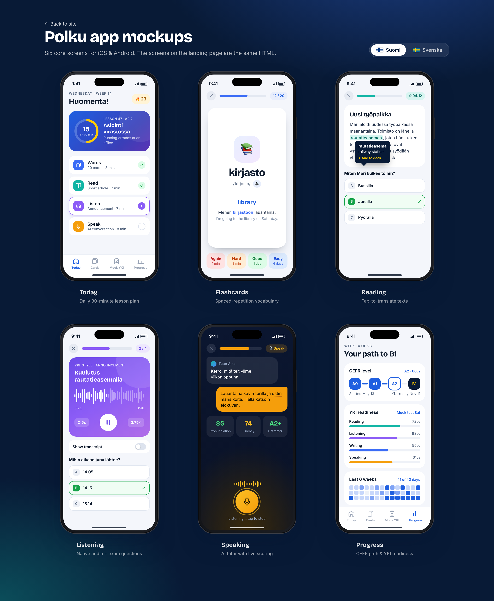

# Polku — YKI prep landing page

Static landing page for **Polku**, a mobile app (iOS & Android) that takes learners from **A0 to B1 in six months** to pass the Finnish **YKI** language test, in **Finnish or Swedish**.

Each daily lesson is **30 minutes**: Words (spaced-repetition flashcards, 8 min) → Read (7 min) → Listen (7 min) → Speak (AI tutor, 8 min).



## Pages

| File | What it is |
|---|---|
| `index.html` | The landing page. All six app screens are built in HTML/CSS inside it. |
| `mockups.html` | Design board showing the six screens side by side (loads them from `index.html`). |
| `assets/styles.css` | Site styles and phone-mockup styles. |
| `assets/app.js` | FI/SV language toggle, generated waveform/heatmap, scroll reveal. |
| `mockups/*.png` | Exported mockup images. |

No build step and no dependencies apart from Google Fonts.

## Run locally

```bash
python3 -m http.server 8000
```

Open http://localhost:8000 (`mockups.html` needs a server because it fetches `index.html`).

## Deploy to GitHub Pages

Settings → Pages → Source: *Deploy from a branch* → `main` / root. The site will be served at `https://<user>.github.io/ykiweb/`.

## Analytics

The site uses [GoatCounter](https://www.goatcounter.com): free, open source, no cookies, so no cookie banner is needed under GDPR.

**Dashboard:** https://polku.goatcounter.com. To change accounts, edit `GOATCOUNTER_CODE` at the top of `assets/app.js` and push. While the code is empty, no analytics script loads at all. Local visits (`localhost`) are never counted.

**What gets counted**

| Event | Meaning |
|---|---|
| page views | Visitors and pages, plus referrers, countries, devices (automatic) |
| `download-ios-hero` / `download-ios-cta` | App Store button, top of page / bottom of page |
| `download-android-hero` / `download-android-cta` | Google Play button, top / bottom |
| `trial-click-pricing` | “Start 3-day free trial” in the pricing card |
| `nav-get-app` | “Get the app” in the top menu |
| `lang-fi` / `lang-sv` | Visitor switched the language preview (interest in Finnish vs Swedish) |

| `waitlist-open-<source>` | Waitlist form opened, and from which button |
| `waitlist-signup` / `waitlist-signup-<language>-<platform>` | Someone joined the waitlist (e.g. `waitlist-signup-finnish-ios`) |

## Launch waitlist (email collection)

While the store links are placeholders, the Download buttons, the “Start 3-day free trial” button and a “Get launch updates by email” link open a **waitlist form**. It asks for an email, Finnish or Swedish, and iPhone or Android, plus a required consent checkbox. It also records which button opened it.

Signups go to [Formspree](https://formspree.io) (the free plan takes 50 a month). Each one is emailed to you and can be exported as CSV.

**Setup:** create a form on Formspree, copy its ID (the part after `/f/`), set `FORMSPREE_ID` near the top of `assets/app.js`, and push. While it's empty, buttons show a “coming soon” toast and the email link is hidden.

**At launch:** set the real store URLs in the `href` of each `class="store"` link. Buttons with a real link go straight to the store.

## TODO before launch

- Set `FORMSPREE_ID` in `assets/app.js` (see Launch waitlist).
- Write a proper privacy policy page before collecting emails at scale (GDPR).
- Replace the `href="#"` store links (search for `class="store"`) with real App Store / Google Play URLs.
- Use official Apple / Google badge artwork per their brand guidelines.
- Final app name and logo (“Polku” is a placeholder).
- Privacy, Terms and Contact links in the footer.
